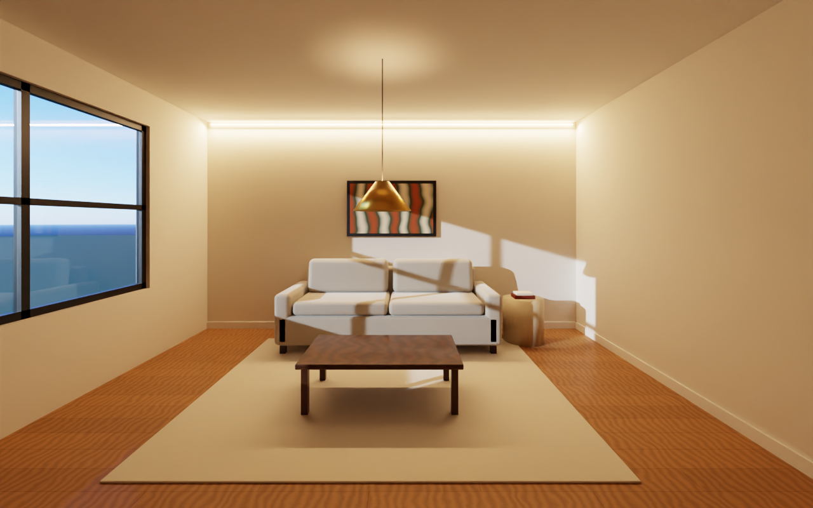
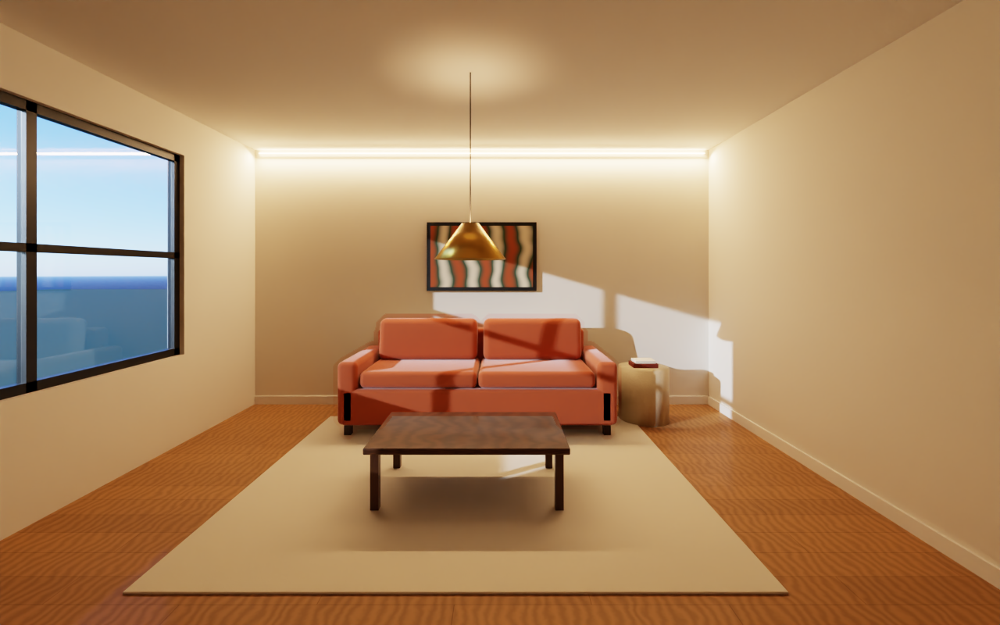
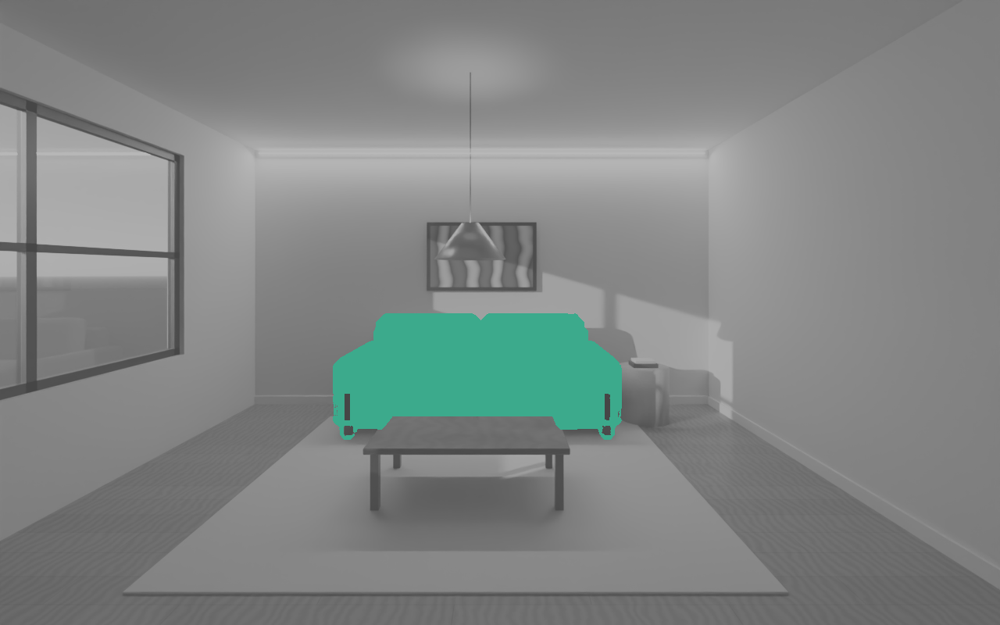

# AI Render: render core (Phase 1)

Upload a SketchUp model, get a photoreal render, and change one thing without anything else moving.

This repo is the first piece: the **render core**. The 3D scene is the source of truth. Every image is a
path-traced render of that scene plus exact helper passes, so later edits, including the AI finish, can be
confined to one object.

## What works today

- **Scene:** a sample 5 m x 5 m living room, or an imported SketchUp export (`.fbx` or `.glb`). Every object gets a
  semantic key (`sofa`, `floor`, `rug`, ...) and an object index.
- **Materials:** procedural PBR finishes (oak and walnut planks, linen, wool, walnut, travertine, plaster, brass, glass).
- **Light:** physical sky + sun per moment (Morning, Midday, Golden hour, Dusk, Night); pendant, LED cove and
  downlights with colour temperature in Kelvin.
- **Render:** Blender Cycles, fixed seed, denoised; deterministic tone mapping with fixed exposure and white balance.
- **Passes:** depth, normals, object IDs, one mask PNG per object.
- **Edits:** scene-first. Change the material in the scene, re-render, then composite only the object's region.
  Outside the region the result is byte-identical to the approved image, and the verifier checks it.

## Run it

```bash
python3.13 -m venv .venv && . .venv/bin/activate
pip install -r requirements.txt
python -m ai_render.demo --out demo_out            # full size, ~15 min on 4 CPU cores
python -m ai_render.demo --out demo_out --fast     # preview size, ~2 min
python -m ai_render.demo --out demo_out --model my_room.fbx
python -m ai_render.report demo_out                # writes demo_out/index.html
pytest -q
```

## Web app (Render Studio)

```bash
uvicorn ai_render.server:app --port 8000     # then open http://localhost:8000
```

Drop in a SketchUp export (`.fbx` or `.glb`) or try the sample room. Pick a moment, switch lights, tap an object
to change its finish, lock objects you have approved, or type a change ("night, sofa forest green"). Every change
is a layer you can switch off. After each edit the app checks that every pixel outside your edits matches the
base render.

Each render runs in a fresh process (`python -m ai_render.cli`) and results are cached, so switching a layer
back on is instant. On 4 CPU cores a preview render (960×600) takes about 40-60 s; a cloud GPU will bring
this to seconds. Set `AI_RENDER_QUALITY=final` for 1920×1200 renders and `AI_RENDER_DATA` for where projects
are stored.

## Layout

| File | What it does |
| --- | --- |
| `ai_render/scene.py` | Sample room, SketchUp import, semantic tags, scene-first `set_finish` |
| `ai_render/materials.py` | Procedural PBR recipes, scanned-texture materials, the finish catalog |
| `ai_render/library.py` | Material library, search, and SketchUp material matching |
| `ai_render/polyhaven.py` | Downloads CC0 scanned materials from Poly Haven |
| `ai_render/lighting.py` | Sky, sun and interior fixtures per moment |
| `ai_render/render.py` | Cycles setup, multilayer EXR read, passes, tone mapping |
| `ai_render/edit.py` | Edit region, masked composite, drift verifier |
| `ai_render/demo.py` | End-to-end proof: approved image, sofa edit, dusk and night |
| `ai_render/service.py` | Projects, edit layers, locks, composition, tap-to-select, intent parser |
| `ai_render/server.py` | FastAPI web API |
| `ai_render/cli.py` | One render in a fresh process (used by the web app) |
| `ai_render/web/index.html` | The Render Studio screen |

## Materials

SketchUp already records which material sits on which face, and the export keeps it. On upload we:

1. List the model's materials (name, colour, texture) without rendering (`cli --inspect`).
2. Match each one to the library from its name and colour (`ai_render/library.py`). For example,
   `Wood_Floor_Oak` becomes Oak planks, and `Fabric_Grey` becomes Linen in the same grey.
   A generic name with nothing to go on (`Color_A01`) is kept as the SketchUp original rather than guessed.
3. Render with those materials, plus a material map (Cycles material index pass).

In the app, tap anything in the picture: the material map says exactly which SketchUp material you hit.
Pick a suggestion or search the library. Every surface with that material changes and nothing else does
(masked composite, same check as other edits). Materials can be locked.

The library has 29 built-in procedural materials. Photo-scanned materials from Poly Haven (CC0) can be added:

```bash
python -m ai_render.polyhaven --search oak
python -m ai_render.polyhaven --get <asset id> --res 2k
python -m ai_render.polyhaven --starter      # the most used scans per category
```

Scans are saved to `data/library/` (or `AI_RENDER_LIBRARY`) and show up in the app with a "scan" tag.
They are mapped at real-world size with box projection, so they work on SketchUp faces without good UVs.

## AI finish (fal)

The path-traced render is the base. The AI finish makes it photoreal with
`fal-ai/flux-general/inpainting`, steered by depth and edge maps taken from the 3D scene, so walls,
furniture and the camera cannot move. The result is pasted back only inside the finish mask, and an
edge check rejects any result whose edges drift (below 85% agreement). After the base is finished once,
each later edit is finished only inside its own region, so the rest of the image never changes.

Setup:

1. Create a key at https://fal.ai/dashboard/keys.
2. `cp .env.example .env` and set `FAL_KEY=...` (or set `FAL_KEY` as an environment secret).
   The key is read on the server only. It is never sent to the browser or logged.
3. Start the server and open the page. The "AI finish" switch becomes active.
   `GET /api/ai` shows the provider, the endpoint and whether the key is present.

Optional settings: `AI_FINISH_ENDPOINT` and `AI_FINISH_UNION` (ControlNet union model path).
Each request ID is logged to `data/<project>/fal_requests.jsonl`, and results are cached by input,
so the same request is never paid for twice.

## Next

1. Tune the AI finish. First real run (2026-11-01, sample room, 960×600): strength 0.35 passed the edge check
   (90% agreement) but the change is subtle and softens the artwork; strength 0.6 was rejected (80%) because it
   erased the sun patches and the artwork. Results come back inline (`sync_mode`), so only `fal.run` /
   `queue.fal.run` need to be reachable, not the `fal.media` CDN.
2. GPU rendering (CUDA/OptiX) for seconds-per-image instead of minutes.
3. Real SketchUp scenes: better automatic labelling of objects and materials.

## Proof renders

Full-size output of `python -m ai_render.demo` (1280×800, 64 samples, 4 CPU cores) is in [`docs/proof/`](docs/proof/).
Changing the sofa to terracotta left 0.00% of pixels outside the sofa changed; a plain full re-render changed 67%
of them slightly (bounce light and denoiser noise).

| Approved | Masked edit | Changed pixels |
| --- | --- | --- |
|  |  |  |
